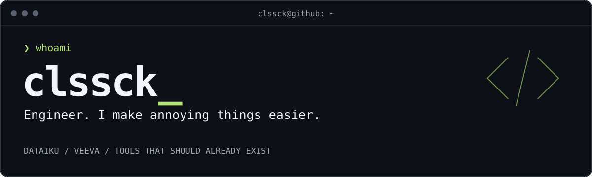

  

I build tools for the parts of work that should not require this many clicks.
Mostly **Dataiku**, **Veeva Vault RIM**, and the glue in between.

[Website](https://ennivalo.com) · [All repositories](https://github.com/clssck?tab=repositories)

## `~/workbench`

### [dataiku-sdk](https://github.com/clssck/dataiku-sdk)

**Dataiku DSS, from code.** A schema-first TypeScript SDK and CLI with runtime validation, built on TypeBox and Bun.

`TypeScript` `Bun` `TypeBox`

## `~/veeva-survival-kit`

Enterprise software builds character. I would rather build tools.

| Tool | One less thing to do manually |
| :--- | :--- |
| **[VeevaBro](https://github.com/clssck/VeevaBro)** | Browser extension for editing Veeva Vault RIM lifecycles. |
| **[VaultRIM_LC_CLI](https://github.com/clssck/VaultRIM_LC_CLI)** | Change Vault RIM lifecycles from the command line. Fewer clicks, more terminal. |
| **[Veeva_RegiNoti](https://github.com/clssck/Veeva_RegiNoti)** | Vault record trigger that notifies the responsible person when a registration changes state. |
| **[HelpdeskPOC](https://github.com/clssck/HelpdeskPOC)** | Helpdesk proof of concept for delivering tasks directly into Vault RIM. |

## `~/bin`

**[sqltoerdiagram](https://github.com/clssck/sqltoerdiagram)** — Turn dbt model metadata into local ER and lineage diagrams.  
**[md2pdf-cli](https://github.com/clssck/md2pdf-cli)** — Markdown to PDF, Mermaid diagrams included.

---

Engineer, not a professional button-clicker. The distinction is an ongoing negotiation.
